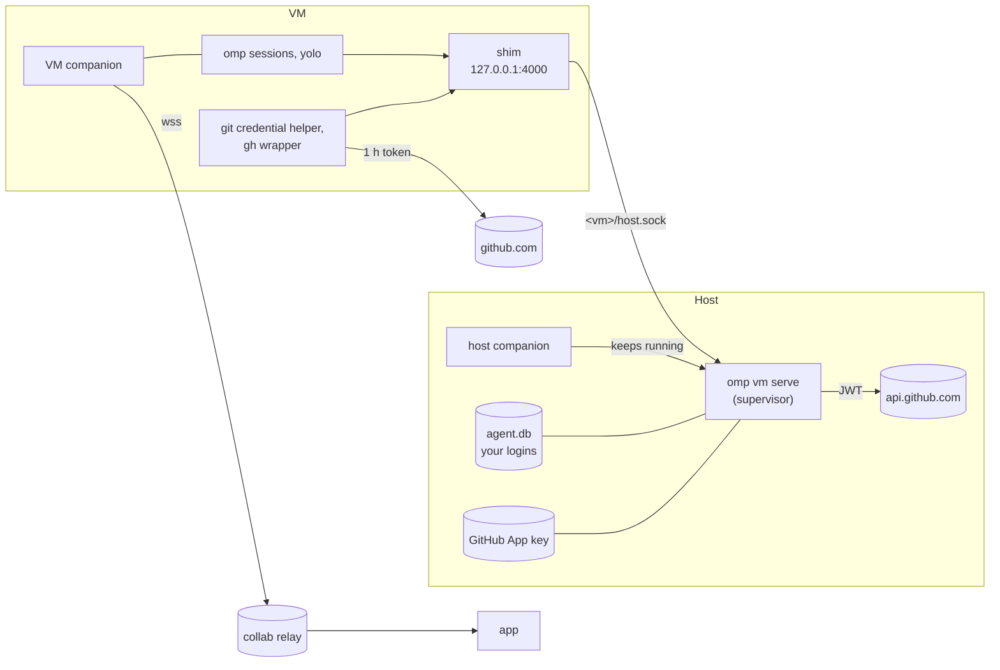

# VM sessions

A VM session runs an agent with no restrictions (root, package installs, Docker, an open network, `yolo` approvals, no shell sandbox) inside a Linux VM on your computer, while:

- your provider logins, subscriptions included (Claude Pro/Max, ChatGPT), never enter the VM;
- GitHub access from the VM covers only the VM's repositories, through tokens that expire within an hour;
- nothing on the host (files, credentials, services on `127.0.0.1`) is reachable from the VM;
- the collab app drives sessions in the VM like sessions on any other computer.

Each VM runs its own omp and its own collab companion, and pairs with your devices as one more computer named `vm-<name>`. *Start session*, *Changes*, commit, push, *Create PR*, the terminal pane, schedules and settle all run inside the VM.

The [shell sandbox](./sandbox.md) stays the tool for work on the host; a VM is for work you would not let near your own account.

## Requirements

| Mode | Host | Needs |
| --- | --- | --- |
| `open` (default) | macOS | [Lima](https://lima-vm.io) with `networkOpts.hostLoopback`: 2.3 or newer. Until 2.3 is released, a build from Lima's `master` (`brew install --HEAD lima`, or `make && make install` from a checkout) |
| `allowlist` | macOS or Linux | QEMU (`brew install qemu`; on Linux `qemu-system-*`, `qemu-img` and `/dev/kvm`) |
| `open` | Linux | QEMU, as for `allowlist`, with an egress proxy that allows every public host |
| Both | | A GitHub App you own (`omp vm github setup`); the collab companion running (it keeps the VM supervisor up) |

`omp vm init` reports what is installed and what is missing.

## Quick start

```sh
omp vm init                                   # what is installed, what is missing
omp vm github setup                           # once: create the GitHub App in the browser and install it on your repositories
omp vm create api --repo acme/api             # boot, provision, clone; prints a pairing link
```

Open the printed link on the device you use the app on, or create and pair the VM from the app: *Add a computer → New virtual machine*, or *Settings → Computers → Virtual machines → New VM*. The app pairs a VM it created on its own.

Inside the VM the repositories are cloned under `~/src/<owner>/<repo>`. Until a session has run in one, the app's *Start session* lists no folders: pick *Choose another folder…* and open `src/<owner>/<repo>`.

## Commands

| Command | Does |
| --- | --- |
| `omp vm init` | Checks Lima, QEMU, the GitHub App and the supervisor; `--json` for scripts |
| `omp vm github setup [--owner <org>]` | Creates the GitHub App through GitHub's manifest flow (a browser page, then the App's install page) and records its installations. `--app-id <id> --key <pem>` adopts an existing App instead |
| `omp vm github status` | The App and the accounts it is installed on |
| `omp vm github protect <owner/repo> [--yes]` | Creates two rulesets with your own `gh`: the default branch blocks deletion, force pushes and direct updates; `v*` and `collab-v*` tags block creation, update and deletion. Repository admins bypass both, so your own pushes keep working; the App does not |
| `omp vm create <name> --repo owner/repo […]` | Creates, boots and provisions the VM and prints a pairing link. Flags: `--cpus` (4), `--memory` GiB (8), `--disk` GiB (60, sparse), `--network open\|allowlist`, `--allow-host <host>` (allowlist extras, repeatable), `--model provider/id` (repeatable; default all), `--daily-tokens N`, `--daily-cost USD` |
| `omp vm list` | VMs and their status (`creating`, `running`, `stopped`, `failed`, `missing`) |
| `omp vm start\|stop <name>` | Boots or shuts down the VM. `start` also refreshes the VM's model config with the providers you are signed in to now |
| `omp vm shell <name>` | A login shell inside the VM |
| `omp vm pair <name>` | A fresh one-time pairing link from the VM's companion |
| `omp vm reset <name>` | Deletes the VM and builds it again from a fresh image, keeping its name, repositories and limits. Nothing carries over from the old guest, pairing included (a compromised guest could have paired a device of its own): it prints a new pairing link, and the old GitHub token is revoked. Remove the old computer from your devices |
| `omp vm delete <name>` | Deletes the VM and its disk; the supervisor closes its sockets and revokes its GitHub token. Paired devices show the computer offline; remove it there |
| `omp vm logs <name>` | The last provisioning transcript |
| `omp vm serve` | The supervisor, in the foreground (the companion runs it; see below) |

`create`, `start`, `stop`, `reset` and `delete` with `--json` write NDJSON: `{"t":"progress","step","message"}` lines, then `{"t":"done",…}` or `{"t":"error","message"}` (exit 1). `list --json` prints `{ready, vms}`; `pair --json` prints `{url, expiresAt}`. The companion runs these commands for the app.

## Architecture



### The supervisor (`omp vm serve`)

One per computer: it holds a kernel lock on `~/.omp/agent/vm/supervisor.json` for as long as it runs, which the system drops when the process exits however it exits, so a crash never leaves a stale owner behind. The host companion starts it as a child while any VM exists and restarts it if it exits; `omp vm create` starts one on its own when none runs (that one stops after five minutes without any VM). A second supervisor waits as a standby and takes over when the first exits.

For each VM it serves `~/.omp/agent/vm/vms/<name>/host.sock` (mode 0600):

| Route | Answer |
| --- | --- |
| `POST /v1/pi/stream`, `GET /v1/models`, and the gateway's other model routes (images, speech, embeddings, judgments, video) | The [auth gateway](./auth-broker-gateway.md)'s routes, in process, on your own credentials (the same local store, OAuth refresh leases and all, as your omp sessions). Each VM is a scoped gateway client: its `models` grants and its daily `budget` apply. The gateway-wide routes (`/v1/usage`, `/v1/credentials/check`) answer 403 |
| `GET /github/token` | `{token, expiresAt}`: a GitHub App installation token for the VM's repositories (below) |
| `GET /healthz` | `ok` |

Nothing on the socket carries a credential the VM could reuse elsewhere: the gateway adds the provider credentials on the host, and the per-VM client token never leaves the supervisor. Deleting a VM (its directory) closes its socket and revokes its GitHub token within two seconds. A VM whose `vm.json` holds a grant or budget the gateway refuses is logged and gets no model access; the other VMs are unaffected.

For QEMU VMs it also serves `vms/<name>/egress.sock`, the VM's HTTP proxy (below).

### The VM

Ubuntu 24.04 (arm64 on Apple silicon, amd64 elsewhere), provisioned over `limactl shell` or SSH:

- git, tmux, socat, curl, build tools, `jq`, and `gh` from GitHub's apt repository;
- the fork's omp and companion, installed by `install.sh --yes --no-login --no-desktop --no-open` (the companion as a systemd user unit, with lingering enabled);
- a shim, systemd user unit `omp-vm-host`, that serves the host socket as `http://127.0.0.1:4000` inside the VM;
- `~/.omp/agent/models.yml`, routing every provider you are signed in to through the shim with `transport: pi-native` (only the model id and the context leave the VM; the request is shaped and signed on the host):

  ```yaml
  providers:
    "anthropic":
      baseUrl: http://127.0.0.1:4000
      apiKey: vm            # placeholder; the host knows the VM by its socket
      transport: pi-native
  ```

- `setupVersion` set so sessions started by the companion never stop at the first-run wizard, and the companion's disk-guard limit scaled to the VM's disk (a tenth of it, at least 2 GB);
- git configured with the App's bot identity (`<slug>[bot]`) and a credential helper, `/usr/local/bin/omp-vm-credential`, that answers github.com with a token from `/github/token`; `/usr/local/bin/gh` wraps the real `gh` with `GH_TOKEN` set the same way;
- each repository cloned under `~/src/<owner>/<repo>`; a repository's `.omp/vm-setup`, when present, runs after the clone (without approval: the VM is the sandbox). Its failure is a warning, not a failed VM.

Chromium is not installed (Ubuntu ships it only as a snap), so the companion's *Preview* reports itself unavailable in VMs.

## Model access and subscriptions

Subscriptions keep working; no API key is needed. The gateway uses what `omp login` stored on the host and builds the provider-specific request there (Anthropic's OAuth headers and Claude Code system block, Codex's account header). The VM sends `{modelId, context}`; it never sees an access or refresh token and cannot change the request shape. Verified end to end with a Claude subscription: a session in a VM, started from the app, edited a file and committed.

A compromised VM can make model calls through its socket while it runs, within its grants. Set a budget: `--daily-tokens` or `--daily-cost` (catalog prices; a subscription is charged against its quota, not this figure). Once a VM's usage for the UTC day reaches either, its model calls get `429 daily_budget_exhausted` until midnight UTC. The check runs when a request starts and usage is counted when it ends, so the requests in flight at that moment can overshoot; a VM with a budget may have at most 16 requests in flight (more get `429 too_many_concurrent_requests` with `retry-after: 1`), which bounds the overshoot. Usage is kept in `vms/<name>/usage.json`, so a supervisor restart does not reset it. Edit `budget` in `vms/<name>/vm.json` to change it; the supervisor applies it within two seconds. omp's own `--max-cost` inside the VM is not a boundary, since the agent controls that process.

The gateway does not read the host's `models.yml`: a model defined only there is not available in the VM.

## GitHub

`omp vm github setup` creates a private GitHub App owned by your account (or `--owner <org>`) with *Contents* and *Pull requests* read and write, *Checks*, *Actions* and *Metadata* read, and no webhook. You click *Create* on GitHub, then install it on the repositories VMs may work on. The App's key stays in `~/.omp/agent/vm/github-app.pem` (0600); the shell sandbox denies reading or writing anything under `~/.omp/agent/vm`.

At run time the supervisor signs a JWT with the key, asks `POST /app/installations/{id}/access_tokens` for a token narrowed to the VM's repositories and those permissions, hands it out on `/github/token`, re-mints it ten minutes before it expires, and revokes it when the VM is deleted or the supervisor stops. A token copied out of the VM is good for at most an hour, for those repositories only.

Verified against a real App on a private repository: the VM cloned it, pushed a branch as the bot and opened a pull request with `gh`; `GET /installation/repositories` with the token listed only that repository, and the token answered 401 a few seconds after `omp vm delete`.

Commits from a VM are authored by the App's bot, so they are recognizable on GitHub. Protect the repositories with `omp vm github protect owner/repo`: the App then pushes work branches and opens pull requests, but cannot move the default branch or create release tags. On this fork that matters most: a push to `main` redeploys the `install.sh` everyone runs, and a `collab-v*` tag publishes a release.

Rulesets need a public repository, or GitHub Pro, Team or Enterprise for a private one; on GitHub Free, `protect` on a private repository fails with GitHub's "Upgrade to GitHub Pro" answer, and nothing stops the App from pushing to its default branch. Until then, give VMs only private repositories where that is acceptable.

All of a VM's repositories must belong to one owner (one installation mints its token).

## Network

| Mode | How | The VM reaches | Not |
| --- | --- | --- | --- |
| `open` (macOS) | Lima, Virtualization.framework, user-mode network, `networkOpts.hostLoopback: false`, no mounts, no port forwards from the guest | The internet, your LAN | The host's `127.0.0.1` services (`host.lima.internal` is refused) |
| `allowlist` | QEMU user network with `restrict=on`: the guest's only ways out are two forwarded addresses, `10.0.2.100:80` (the host socket) and `10.0.2.101:3128` (`egress.sock`, an HTTP proxy) | Hosts on the list, through the proxy | Everything else, the LAN, the host. No DNS either: the proxy resolves names |
| `open` (Linux) | As `allowlist`, the proxy allowing every public host | The internet | The LAN and the host |

The proxy resolves each name on the host and refuses loopback, private, link-local, CGNAT, unique-local and multicast addresses whatever the list says, then connects to the address it checked. Only ports 80 and 443. The default list covers GitHub (`github.com`, `api.github.com`, `codeload`, the release and raw content hosts, `cli.github.com`), what the installer's build-attestation check fetches (the Sigstore trust roots `tuf-repo.github.com` and `tuf-repo-cdn.sigstore.dev`, and GitHub's bundle store `tmaproduction.blob.core.windows.net`), Ubuntu's mirrors, `ctrlc03.github.io` (the installer), the collab relay `my.omp.sh`, and the npm, crates.io, Rust and PyPI registries; `--allow-host` adds more, exact or `*.suffix`. Refused connections are logged in the supervisor's output.

`hostLoopback: false` does not cover the host's other addresses: a service on the host bound to all interfaces is still reachable from an `open` VM through the host's LAN address. Bind host services to `127.0.0.1`, or use `allowlist`.

Whatever the mode, anything in the VM can leave through its egress: the repository's code, the current GitHub token, transcripts. The design limits what that is worth, not whether it can leave.

## Threat model

Assume the agent in a VM is fully compromised (prompt injection, a malicious dependency).

| Asset | Where it lives | Exposure |
| --- | --- | --- |
| Provider logins and refresh tokens | Host store | None directly. Model calls through the VM's socket while the VM runs, within its grants and budget |
| Gateway client token | Supervisor memory | None: it never leaves the host |
| GitHub | One-hour token in the VM | Read the VM's repositories, push branches, open pull requests. Not the default branch or release tags once `protect` ran. Revoked on delete |
| GitHub App private key | Host, 0600, denied to the shell sandbox | None |
| Host files, SSH keys, `~/.omp`, git credentials | Host, nothing mounted | None |
| Host services on `127.0.0.1` | Host | Refused |
| Host services bound to all interfaces | Host | Reachable from `open` VMs through the LAN address |
| Repository source and transcripts in the VM | VM disk | Can leave in `open` mode, or to an allowed host |
| Your LAN | | Reachable in `open` mode on macOS; not otherwise |
| Devices paired with the VM's companion | Phone, browser, desktop app | The VM's companion is a peer the app talks to; it can show crafted content and refuse or fake answers about itself, and cannot act on other computers (each computer is its own room and key) |

## Measurements

On an Apple silicon Mac (macOS 27), Lima built from `master`, QEMU 11.1:

| Step | Time |
| --- | --- |
| `create`, `open` (Lima), image cached, one small repository | 56 s |
| `reset`, `open` | 53 s |
| `start` after `stop` | 9 s |
| `stop` | 2 s |
| `create`, `allowlist` (QEMU), image download included | 1 min 58 s |
| `reset`, `allowlist` (QEMU), image cached | 1 min 45 s |
| QEMU boot to SSH, image cached | 13 s |
| Model call from the VM (Claude Haiku, `omp -p`) | 2–4 s |

## Implementation

| Part | Where |
| --- | --- |
| CLI | `packages/coding-agent/src/commands/vm.ts`, `src/vm/cli.ts` |
| Records and paths | `src/vm/types.ts`, `src/vm/store.ts`, `src/vm/paths.ts` |
| Drivers | `src/vm/driver.ts` (interface), `src/vm/lima-driver.ts`, `src/vm/qemu-driver.ts`, `src/vm/drivers.ts` (choice) |
| Guest provisioning | `src/vm/guest.ts` |
| Supervisor | `src/vm/supervisor.ts` |
| Egress proxy | `src/vm/egress-proxy.ts` |
| GitHub App | `src/vm/github*.ts` |
| Gateway budgets | `packages/ai/src/auth-gateway/budget.ts`, `clients.ts`, `dispatch.ts` |
| Companion | `packages/collab-web/scripts/companion-vm.ts`; the relay connection honours `HTTPS_PROXY` (`companion-room.ts`) so `allowlist` VMs reach the relay |
| App | `packages/collab-web/src/components/shell/VmSettings.tsx`, `VmCreateForm.tsx`; wire types `packages/wire/src/vm.ts` |

## Not done

- **Vendor agents in the VM.** Claude Code and Codex use their own logins, not omp's; the VM's *Agents* screen shows them as not signed in. They might use the gateway's `/v1/messages` and `/v1/responses` routes through `ANTHROPIC_BASE_URL` and a custom Codex provider; untested.
- **Ephemeral per-session VMs** (a copy-on-write clone of a provisioned VM per session), for untrusted pull requests.
- **No GitHub token in the VM at all**: a host-side git and API proxy that adds the token itself.
- **Recent folders.** A fresh VM lists no folders under *Start session* until a session ran in one.
